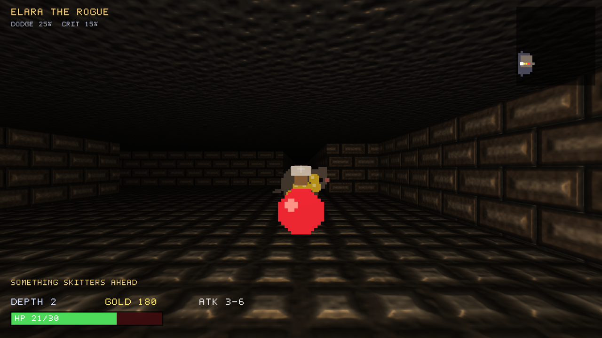
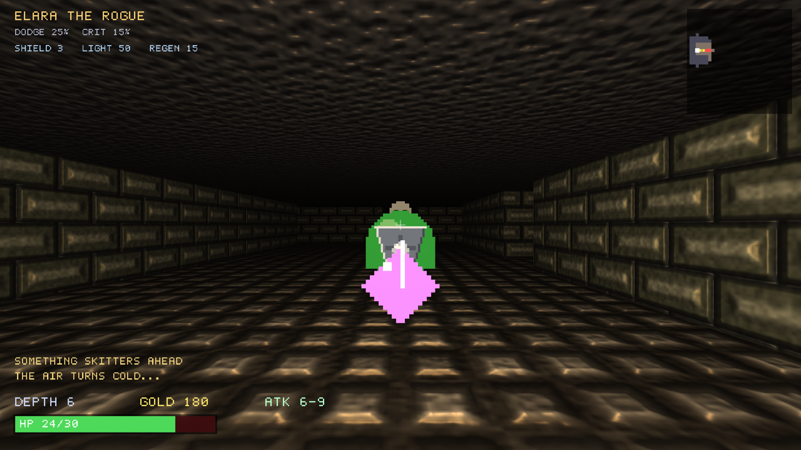
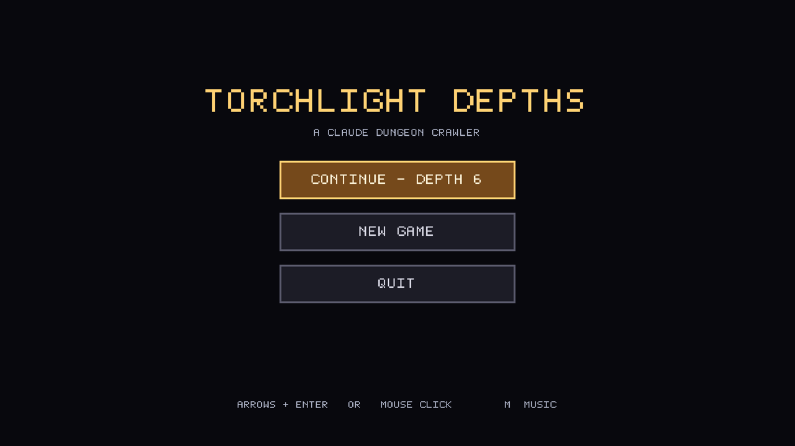
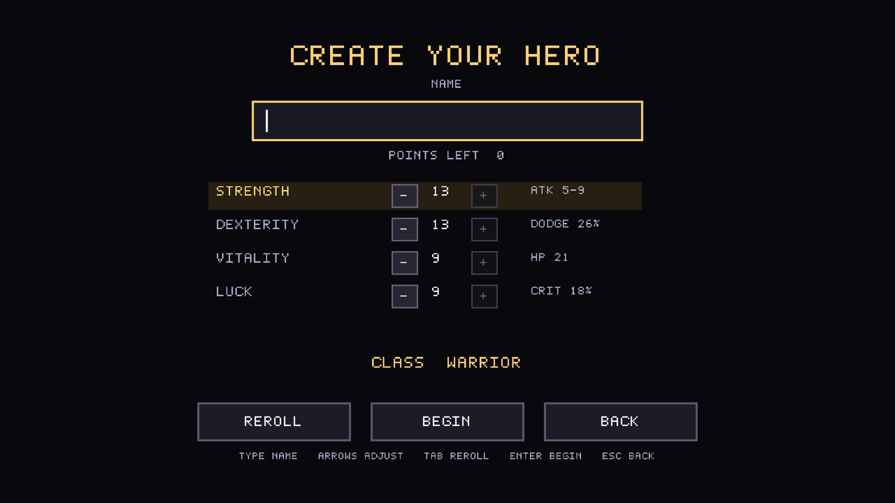

# Torchlight Depths

A first-person, grid-based dungeon crawler in the spirit of *Dungeon Master* and
*Eye of the Beholder* — written from scratch in **C#** with **OpenGL 4.1** (via
[OpenTK](https://opentk.net/)). Every texture, sprite, and font glyph is generated
in code, so there are **no external asset files**.

 

## Screenshots

| Exploring the upper floors | Deeper down, buffs lit |
|:--:|:--:|
|  |  |
| **Title menu** | **Create your hero** |
|  |  |

*Bump/normal-mapped stonework, a single torch point-light with distance falloff,
and camera-facing alpha-cutout sprites — all procedurally generated, no asset files.*

## Play

```bash
dotnet run -c Release
```

(First run restores the OpenTK NuGet package.)

The game opens on a **menu** — **New Game**, **Continue** (shown only when a save
exists), and **Quit**. Navigate with the arrow keys + `Enter`, or click with the
mouse.

Choosing **New Game** takes you to **character creation**: type a name and spend a
**point-buy** budget across four attributes (arrow keys, or the on-screen −/+
buttons; `Tab` / **Reroll** randomizes the spread). Your **class is auto-assigned**
from your dominant attribute. Press `Enter` / **Begin** to descend.

## Controls

| Key            | Action                          |
|----------------|---------------------------------|
| `W` / `Up`     | Step forward (bump to attack)   |
| `S` / `Down`   | Step back                       |
| `A` / `Left`   | Turn left                       |
| `D` / `Right`  | Turn right                      |
| `Q` / `E`      | Strafe left / right             |
| `Space` / `F`  | Attack the tile ahead           |
| `Enter`        | Respawn (on the death screen)   |
| `M`            | Toggle music on / off           |
| `F11`          | Toggle fullscreen / windowed    |
| `Esc`          | Pause to the menu (auto-saves)  |

The game launches **fullscreen at 1920×1080** (press `F11` for a window).

## Your hero

At character creation you distribute a shared **point-buy budget** (44 points,
each attribute 3–18) — or hit **Reroll** to scatter it randomly. Each attribute
shapes how your run plays, previewed live as you spend:

| Attribute     | Effect                                                     |
|---------------|------------------------------------------------------------|
| **Strength**  | Attack damage — sets your min/max hit (`1 + STR/4` … up)    |
| **Dexterity** | Dodge chance — % to negate an incoming hit (`DEX×2`, ≤40%)  |
| **Vitality**  | Health — your max HP is `12 + VIT`                          |
| **Luck**      | Crit chance (`LUK×2`, ≤40%, doubles damage) + better loot   |

### Class

Your **class is auto-assigned** from your highest attribute, and grants a passive:

| Dominant stat | Class       | Passive          |
|---------------|-------------|------------------|
| Strength      | **Warrior** | +1 attack        |
| Dexterity     | **Rogue**   | +5% dodge        |
| Vitality      | **Guardian**| +4 max HP        |
| Luck          | **Trickster**| +5% crit        |

Name, attributes, class, dodge, and crit are all saved with the run, so
**Continue** brings the same hero back. Your name/class and dodge/crit show in the
top-left during play.

### Death & revival

When you fall you can **spend gold to revive** (cost `30 + depth×20`): press `C` on
the death screen to get back up right where you fell at full health. Can't
afford it (or would rather start fresh)? Press `Enter` to roll a **new hero**.
Dying clears the save unless you revive.

## How it plays

- Explore procedurally generated dungeons lit only by your **torch** — light falls
  off with distance, so the dark ahead always holds a little dread.
- **Bump into monsters to fight them.** Rats and bats haunt the upper floors;
  slimes and skeletons wait below. Every enemy you don't kill takes a step toward
  you each turn.
- Grab a wide range of loot — most take effect the instant you step onto them:
  - **Potion / bread** — restore HP. **Heart** — permanently raises max HP.
  - **Gold / gem** — score (and revive currency); gems are a fat payout.
  - **Blade** — permanent +attack. **Whetstone** — a bigger, *temporary* +attack.
  - **Ring** — permanent +dodge & +crit.
  - **Shield** — halves incoming damage for the next few hits, then shatters.
  - **Torch oil** — your torch blazes brighter and farther for a while.
  - **Healing herb** — regenerates HP over the next several turns.
  - **Hourglass** — freezes every enemy in place for a spell.
  - **Boots of haste** — you move twice for each step the monsters take.
  - **Map** — reveals the whole floor on the minimap at once.
  - **Fire scroll** — erupts on pickup, scorching every nearby enemy.

  Loot also drops from the slain. Active timed effects show under your hero banner.
- Find the glowing **stairs** (cyan on the minimap) to descend. Each floor is
  larger, darker, and deadlier — and the stonework changes palette as you go.
- Die and you restart from depth 1. How deep can you get?

The **minimap** (top-right) fills in as you explore. Your health, depth, gold, and
attack range sit along the bottom, with a scrolling combat log above them.

## Saving & continuing

Your run is written to disk automatically:

- at the **start of every level** (including the first), and
- whenever you **leave the game** — pressing `Esc` to the menu, or closing the window.

Pick **Continue** from the menu to resume exactly where you left off: the same
floor layout, your position and facing, every monster and item, the explored
minimap, and all your stats. Dying deletes the save (a fallen hero can't be
continued). The save lives at:

```
~/.config/TorchlightDepths/save.json      # Environment.SpecialFolder.ApplicationData
```

## iPhone & iPad

The game also runs on iOS. The `ios/` project builds a native iPhone and iPad app
from the same `src/` code, played in landscape with touch controls:

| Gesture / button       | Action                                  |
|------------------------|-----------------------------------------|
| Swipe **up**           | Step forward (bumps into a monster to attack) |
| Swipe **down**         | Step back                               |
| Swipe **left / right** | Turn left / right                       |
| **MENU** button        | Pause to the menu (auto-saves)          |
| **MUSIC** button       | Toggle music                            |

The hero's name is typed on an **in-game keyboard** drawn in the game's own style
(letters, numbers, space, DEL). Tap the name box to bring it up. On the death
screen, **REVIVE** and **NEW HERO** are buttons. A hardware keyboard on an iPad
works the same way as on desktop. Leaving the app saves your run and drops you
to the menu.

Requirements: Xcode and the .NET iOS workload (`dotnet workload install ios`).

```bash
ios/run-sim.sh                            # build + launch in the iPhone 17 Pro simulator
ios/run-sim.sh "iPad Pro 13-inch (M5)"    # ...or any other simulator
ios/run-sim.sh "iPhone 17" --capture      # scripted touch walkthrough with screenshots
```

The Simulator renders OpenGL ES on the CPU, so it runs at a few frames per second
there. Real devices draw it on the GPU.

To install on a connected iPhone or iPad (paired, with Developer Mode on):

```bash
ios/run-device.sh              # first connected device
ios/run-device.sh iPadAir4     # or match part of the device name
```

This signs with an Apple Development certificate and a development provisioning
profile that lists the device (a wildcard `*` team profile works). Set
`CODESIGN_KEY` / `CODESIGN_PROVISION` to use different ones.

The app icon is rendered by the game itself. `dotnet run -c Release -- --icon icon.bmp`
draws one square, HUD-free frame (a skeleton in a torchlit corridor). Convert it
with `sips -s format png -Z 1024 icon.bmp --out ios/Assets.xcassets/AppIcon.appiconset/AppIcon-1024.png`.

## Project layout

| File                | Responsibility                                            |
|---------------------|-----------------------------------------------------------|
| `src/Desktop/`      | Desktop host: OpenTK window, OpenGL 4.1 core context, OpenAL backend |
| `ios/`              | iOS host: GLKView + OpenGL ES 3.0, AVAudioEngine mixer, touch / scene lifecycle |
| `src/Game.cs`       | Game loop: movement, combat, AI, levels, rendering, HUD   |
| `src/Touch.cs`      | Touch controls: swipes, on-screen buttons, name keyboard  |
| `src/Dungeon.cs`    | Procedural room-and-corridor level generation             |
| `src/Gfx.cs`        | Shader / Mesh / Texture helpers (cube, billboard, quads)  |
| `src/Textures.cs`   | Procedural stone/floor textures and monster/item sprites  |
| `src/Font.cs`       | Hand-authored 8×8 bitmap font baked to an atlas           |
| `src/Hud.cs`        | 2D batched text + quad renderer for the interface         |
| `src/Audio.cs`      | Procedurally-synthesized sound effects (playback via `IAudioOut`) |
| `src/MusicGen.cs`   | Procedural per-level music synthesis                      |
| `src/Save.cs`       | JSON save/load of the full run state                      |

## Technical notes

- Targets an OpenGL **4.1 core, forward-compatible** context — the highest OpenGL
  macOS exposes — using GLSL `#version 330 core` shaders.
- One torch point-light with distance attenuation drives all world and sprite
  shading; a subtle flicker is layered on in the fragment stage.
- Monsters and items are **camera-facing billboards** with alpha-cutout sprites.
- Grid movement is discrete but **tweened** for smooth turning and stepping.
- The Retina-correct viewport uses the **framebuffer** pixel size, so rendering
  fills the whole window on HiDPI displays.
- `Game` owns no window. A host creates the GL context and forwards frames, keys
  and pointer events, which is what lets one codebase run on desktop and iOS. On
  iOS the shaders are rewritten to `#version 300 es`, and `ios/GLES.cs` binds the
  GL calls directly, because OpenTK's GL bindings need a JIT that iOS forbids.
- Each level's walls, floor and ceiling are baked into three static meshes, so the
  world draws in a handful of draw calls.

### Sound

All audio is **synthesized in code** at startup — no sound files. `src/Audio.cs`
is a tiny software synth (oscillators, noise, one-pole filters, decay envelopes)
that bakes each effect to a PCM buffer and plays it through OpenAL: footsteps,
wall bumps, sword swings, impacts, monster deaths, taking damage, coins, potions,
power-ups, the descent chime, and a death arpeggio — over a low looping cave
drone. If no audio device is present the engine fails soft and the game runs
silently.

### Music

Each level also gets its **own procedurally-composed music track** (`src/MusicGen.cs`).
Seeded by depth, it picks a tempo, a minor (or, deeper down, Phrygian) scale, a
chord progression, and a random-walk melody, then renders an ~20-second loop from
pad, bass, pluck, kick and hat voices. Tracks are generated on a **background
thread** so descending never hitches, and swapped in when ready. Press **`M`** to
toggle the music (SFX and ambience keep playing); an indicator shows when it's off.
